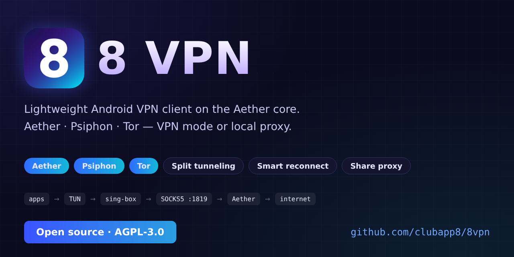
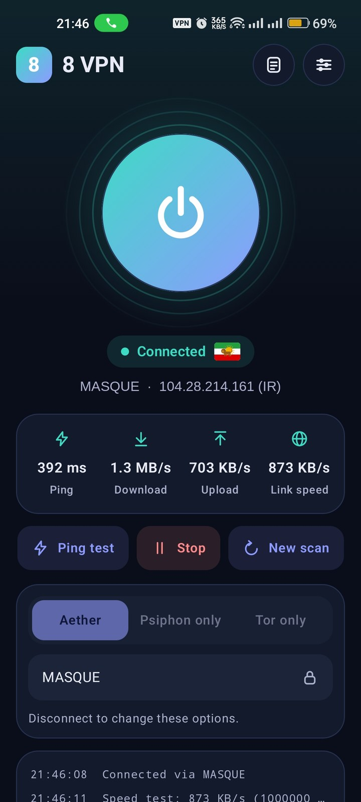
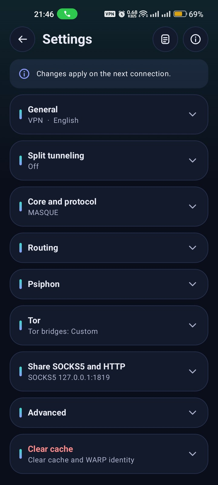
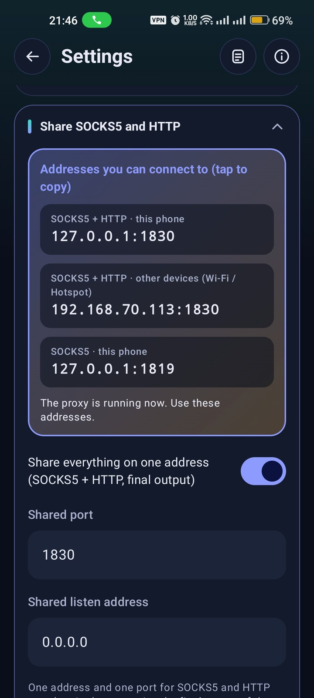
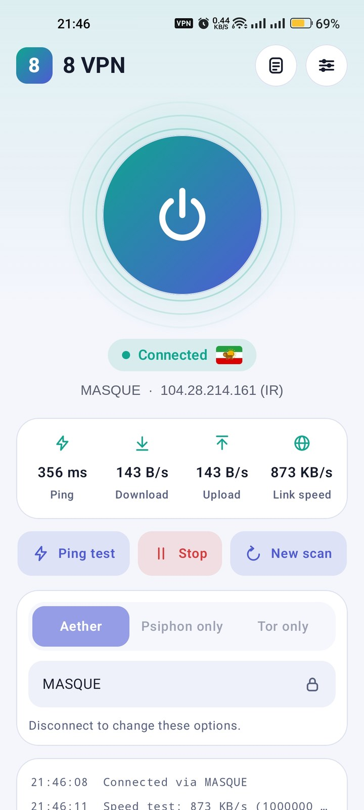
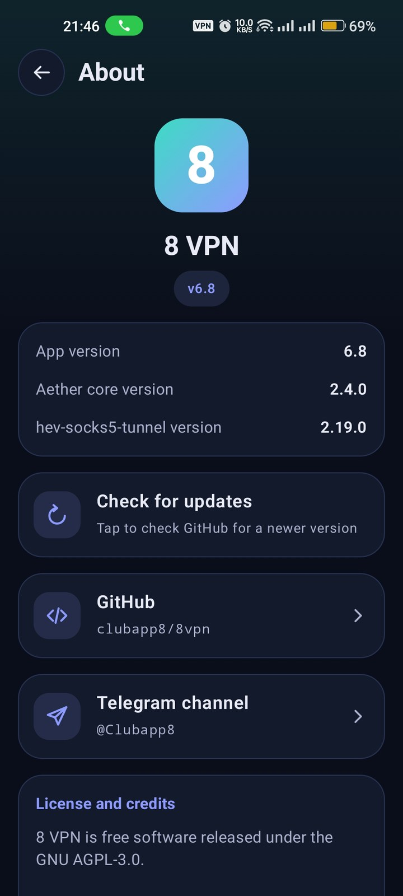
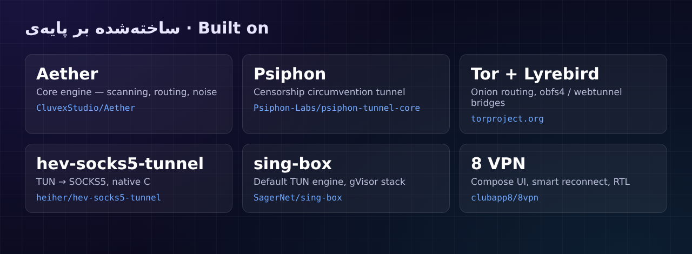

<div align="center">



**[English](README.md#english) · [فارسی](README.md#فارسی) · [日本語](#japanese)**

[](https://t.me/Clubapp8)
[](LICENSE)


</div>

---

<a id="japanese"></a>

# 8 VPN — 日本語

**Aether** コアをベースに構築された軽量な Android 向け VPN クライアントです。デフォルトの TUN エンジンには **sing-box**（libbox）を、フォールバックには **hev-socks5-tunnel** を使用しています。
Jetpack Compose と Material 3 で作られており、デフォルトはダークテーマで、英語とペルシア語（RTL）に対応しています。

📢 Telegram チャンネル：<https://t.me/Clubapp8>

## 機能

- **2つのモード**：VPN（デバイス全体の通信がトンネルを通ります）またはプロキシのみ（ローカルの SOCKS5 と、オプションの HTTP プロキシ）。VPN / プロキシの切り替えとルートの切り替えは **Settings** にあるため、ホーム画面はすっきりしたままです。
- **ルートの切り替え**：Aether、Aether → Psiphon、Aether → Tor、Psiphon のみ、Tor のみ、および逆方向のルート（Psiphon → MASQUE、Tor → MASQUE）。
  Aether のプロトコル：MASQUE、WireGuard、WARP-in-MASQUE（Gool）、WARP-in-WARP（Gool classic）、MASQUE-in-MASQUE。Psiphon ではリージョンとモードを選択でき、Tor には **カスタムブリッジ** を含むブリッジのオプションがあります（obfs4 と webtunnel の行を固定サイズのスクロール可能なボックスに入力でき、Telegram ボット @GetBridgesBot からブリッジを取得して貼り付けるボタンもあります）。
- **スマート再接続**：コアが停止したとき、ping が失敗したとき、またはネットワークが切り替わったとき（Wi-Fi ↔ モバイルデータ）に再接続します。ゲートウェイを新たにスキャンして再試行するか、最後に動作したゲートウェイにすばやく戻ります。
- **カスタムエンドポイント**：独自のゲートウェイ `IP:port`（外側と内側のホップ）を設定して、スキャンをスキップできます。
- **プロキシをほかのデバイスと共有**：ホットスポットや USB テザリング経由で、ノートパソコンや別のスマートフォンから SOCKS5 / HTTP プロキシを使えるようにします。*Share SOCKS5 and HTTP* セクションには、接続できるすべてのアドレスが1つのボックスに一覧表示され（タップでコピー）、このスマートフォンでの HTTP とほかのデバイス向けの HTTP をそれぞれ別のスイッチで切り替えられます。
- **すべてを1つのアドレスで**：*Share everything on one address* を使うと、SOCKS5 と HTTP を1つのポート（デフォルトは `1830`）で提供し、常に接続中のモード（Aether、Aether → Psiphon、Aether → Tor、Psiphon のみ、Tor のみ）の **最終出力** を流します。
- **スプリットトンネリング**：選択したアプリだけを含める、または除外できます。
- **ルーティングルール**：ブロックリストとダイレクトリスト（ドメイン、IP、CIDR、ポート）、トンネル内のカスタム DNS、上流プロキシ（`socks5://` または `http://`）。
- **一時停止と再開**：Stop ボタンはコアを動かしたまま VPN だけをオフにするため、Start ですぐに再開できます。
- **チューニング**：スキャンレベル、難読化プロファイル、IP バージョン、パフォーマンスプロファイル、TUN MTU、TCP バッファ、ping の間隔と失敗回数、接続の試行回数と遅延、Aether の追加引数。
- **ライブ情報**：ping、ダウンロード/アップロード速度、リンク速度、国旗付きの出口 IP、最後に切断された理由、コピーや共有ができるログ。
- **アップデートの確認**：About 画面から GitHub の最新リリースを確認します。自動で何かをダウンロードしたりインストールしたりすることはありません。
- **折りたたみ式の設定**：General、Split tunneling、Core and protocol、Routing、Psiphon、Tor、Share SOCKS5 and HTTP、Advanced、Clear cache がそれぞれ独立したセクションになっており、Settings の上部にログボタンがあります。
- クイック設定タイル（ステータスバーから VPN を切り替え）、起動時の自動開始、バッテリー最適化へのショートカット、ダイナミックカラー（Android 12 以降）、ダーク / ライトテーマ。
- 完全な RTL サポートを備えた英語とペルシア語の UI。

## スクリーンショット

<p align="center">
  
  
  
  
  
</p>

## 仕組み

```
VPN mode:    apps -> VpnService (TUN) -> sing-box (gVisor stack) -> SOCKS5 127.0.0.1:1819 -> Aether / Psiphon / Tor -> internet
Proxy-only:  apps -> SOCKS5 127.0.0.1:1819 (or HTTP 127.0.0.1:1822) -> Aether / Psiphon / Tor -> internet
```

ポート：SOCKS5 は `1819`（変更可能）、Tor は `1820`、Psiphon は `1821`、オプションの HTTP は `1822`（変更可能）、共有の単一アドレスは `1830`（変更可能、デフォルトでは `0.0.0.0` で待ち受け）です。

**TUN エンジン**（Settings → VPN engine）：

- **sing-box**（デフォルト）：DNS には sing-box が応答します（プロキシ経由の DNS over TCP）。Psiphon と Tor では DNS 以外の UDP をすぐに拒否するため、アプリは QUIC から TCP にフォールバックします。
- **hev-socks5-tunnel**：軽量な代替エンジンです。sing-box ライブラリが見つからない場合や起動に失敗した場合、アプリは自動的にこちらにフォールバックします。

## エンジンとクレジット



| コンポーネント | 役割 | リンク | ライセンス |
|---|---|---|---|
| **Aether** (CluvexStudio) | すべてのルートで使われるコアエンジン | <https://github.com/CluvexStudio/Aether> | AGPL-3.0 |
| **sing-box** (libbox) | デフォルトの TUN エンジン（gVisor スタック） | <https://github.com/SagerNet/sing-box> | GPL-3.0（追加条項あり） |
| **Psiphon** (psiphon-tunnel-core) | 検閲回避ルート | <https://github.com/Psiphon-Labs/psiphon-tunnel-core> | GPL-3.0 |
| **Tor** | オニオンルーティングのルート | <https://www.torproject.org> | BSD-3-Clause |
| **Lyrebird** | Tor のプラガブルトランスポート（obfs4、webtunnel） | <https://gitlab.torproject.org/tpo/anti-censorship/pluggable-transports/lyrebird> | BSD-3-Clause |
| **hev-socks5-tunnel** | フォールバック用の TUN → SOCKS5 エンジン | <https://github.com/heiher/hev-socks5-tunnel> | MIT |

> 最新のライセンス条件は、各上流リポジトリで確認してください。

## 注意事項

- Aether は AGPL-3.0 のため、このプロジェクトも AGPL-3.0 です（[LICENSE](LICENSE) を参照）。
- Aether の商標ポリシーでは、派生製品に独自の名前とブランドを使うよう求めているため、アプリの名前は **8 VPN** とし、コアはクレジットとしてのみ記載しています。
- Psiphon のリージョン一覧は静的なもので、実際に利用できるリージョンは Psiphon のサーバーによって異なります。
- カスタムの Tor ブリッジは obfs4、webtunnel、プレーンブリッジのみに対応しており、それ以外のトランスポートはスキップされます。
- プロキシを共有すると、同じホットスポットや Wi-Fi ネットワーク上の誰でもそれを利用できます。ホットスポットには強力なパスワードを設定し、使い終わったら共有をオフにしてください。
